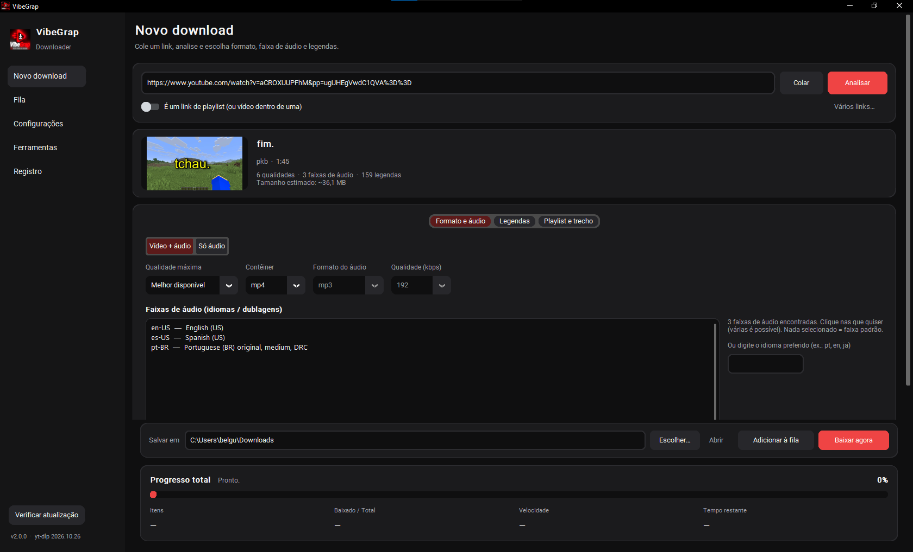
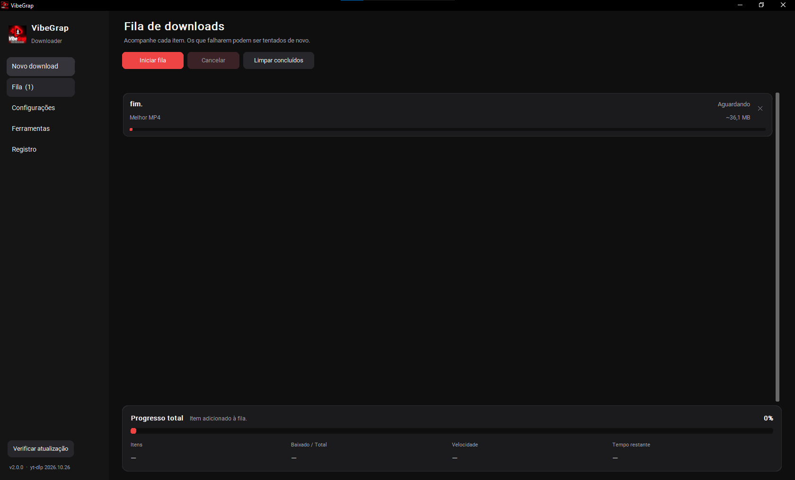

# VibeGrap

[](../../releases)
[](../../actions/workflows/tests.yml)
[](LICENSE)

Interface gráfica moderna, em português, para o [yt-dlp](https://github.com/yt-dlp/yt-dlp): baixe vídeos e áudio escolhendo qualidade, **faixa de áudio (idioma/dublagem)**, legendas, itens de playlist e trechos, com fila de downloads e **progresso total** (itens, bytes, velocidade e tempo restante). Funciona com os milhares de sites que o yt-dlp suporta, não só o YouTube.

> O VibeGrap é um programa de *vibe coding*, desenvolvido por **casisDev**: ele descreveu o que queria em linguagem natural e o código foi escrito e testado com a ajuda de uma IA. Detalhes em [Sobre este projeto](#sobre-este-projeto).

## Recursos

**Downloads**

- Análise do link com miniatura, título, duração e **tamanho estimado** antes de baixar
- Vídeo (MP4, MKV, WEBM, até 4K) ou só áudio (MP3, M4A, Opus, FLAC, WAV ou o original)
- **Escolha da faixa de áudio** (uma ou várias dublagens no mesmo arquivo)
- Legendas manuais e automáticas, para embutir no vídeo ou guardar à parte
- Trecho do vídeo (início/fim), com opção de corte preciso
- Metadados, capítulos e miniatura embutidos no arquivo
- Modelos de nome: `Título`, `Título [id]`, `Canal - Título` e `Nº - Título (playlists)`

**Playlists**

- Marque os itens com o clique ou digitando faixas como `1-10`, `1, 2, 3` ou `1-5, 8, 12-`
- Extraia só o áudio de **todos** os itens de uma vez
- Pasta própria para playlists, com o nome da lista

**Fila e histórico**

- Fila com progresso por item e **painel de progresso total**, com cancelamento, “limpar concluídos” e nova tentativa para os que falharam
- Histórico com busca, “abrir pasta”, “copiar link” e “usar de novo”
- Aviso na tela quando os downloads terminam, mesmo com o programa em segundo plano

**Programa**

- Cookies do navegador (ou arquivo `cookies.txt`), proxy e limite de velocidade
- Tema claro, escuro ou **sistema** (vermelho, branco e preto)
- Aba **Ferramentas** para baixar/atualizar ffmpeg, Deno e yt-dlp (conferido por hash)
- Aba **Registro** com as mensagens detalhadas do yt-dlp
- **Botão de atualização:** avisa quando há versão nova e instala com um clique

## Como usar

1. Cole o link e clique em **Analisar** — é o que traz o título, as qualidades e os itens da playlist.
2. Escolha a qualidade, a faixa de áudio, as legendas e, em playlists, marque os itens.
3. Clique em **Baixar agora** ou **Adicionar à fila** e acompanhe na aba **Fila**.

Os downloads vão para a pasta escolhida no topo da tela. O **Histórico** guarda o que já foi baixado, com botão para abrir a pasta de cada item.

## Capturas de tela

<p align="center">
  
  
</p>

## Instalação (Windows 10/11, 64 bits)

1. Abra a página **[Releases](../../releases)** deste repositório.
2. Baixe **`VibeGrap-Setup.exe`** e dê dois cliques.
3. Siga o assistente. Não precisa de senha de administrador. O instalador já inclui o ffmpeg e o Deno.

**Avisos normais do Windows:** o instalador não é assinado digitalmente (assinatura é paga), então o Windows pode mostrar “O Windows protegeu o computador”: clique em **Mais informações → Executar assim mesmo**. Alguns antivírus marcam programas feitos com PyInstaller por engano (falso positivo). Se desconfiar, **construa você mesmo** a partir do código (abaixo) e compare.

Para desinstalar, use **Configurações → Aplicativos → VibeGrap**. Suas preferências e o histórico ficam em `%APPDATA%\VibeGrap`; apague essa pasta se quiser voltar ao padrão.

## Atualizações

Na barra lateral do programa há o botão **Verificar atualização**. Quando existe uma versão nova publicada em **Releases**, o botão muda para **“Atualizar para vX.Y.Z”**: um clique atualiza e abre o programa de novo, sem perder suas configurações. Dá para desligar a verificação automática em **Configurações**. As novidades de cada versão estão no [CHANGELOG.md](CHANGELOG.md) e na página do Release.

- **Atualização leve:** quando só o código do VibeGrap mudou, o programa baixa apenas um pacote pequeno (alguns MB, conferido por SHA-256) e troca só o `VibeGrap.exe` e os arquivos de `assets`. O ffmpeg e o Deno não são baixados de novo.
- **Instalador completo:** usado automaticamente quando as bibliotecas embutidas mudaram, quando a pasta de instalação não permite escrever, ou se a atualização leve falhar. Quem tem uma versão anterior também recebe o instalador completo desta vez.
- Cada Release traz os dois: `VibeGrap-Setup.exe` e `VibeGrap-App-<código>.zip` (com o `.sha256`). Você não precisa baixar o `.zip` à mão.

## Construir a partir do código

**Instalador automático (GitHub Actions):** o arquivo `.github/workflows/build.yml` monta o instalador num computador Windows do GitHub. Rode-o na aba **Actions → Construir instalador (Windows) → Run workflow**; o resultado fica em *Artifacts*. Ao publicar uma versão (tag `v2.0.0`, por exemplo), o `VibeGrap-Setup.exe` é anexado à página **Releases** automaticamente, e é daí que o botão de atualização do programa busca as novidades.

**No seu PC:** descompacte, entre na pasta e dê dois cliques em `Criar-Instalador.bat`. Ele instala o que faltar (Python e Inno Setup, pelo winget) e cria `installer_output\VibeGrap-Setup.exe`. (Cópias feitas assim não têm o botão de atualização ligado a um repositório.)

**Rodar sem instalar (desenvolvimento):** precisa de **Python 3.11 ou mais novo** (o instalador é montado com 3.12) e do **ffmpeg** no `PATH`.
```
pip install -r requirements.txt
python ytdlp_gui.py
```

**Testes:** `python tests/test_app.py` (no Linux: `xvfb-run -a python tests/test_app.py`). Eles usam uma pasta temporária, não mexem nas suas configurações, precisam do `ffmpeg` no `PATH` e levam cerca de 1 minuto. No GitHub, o workflow **Testes** roda no Linux a cada envio.

## Estrutura

| Arquivo | Para que serve |
|---|---|
| `ytdlp_gui.py` | O programa inteiro |
| `assets/` | Ícone, logo e arquivos gerados na build (`version.txt`, `update_repo.txt`, `base_id.txt`) |
| `docs/` | Capturas de tela usadas neste README |
| `installer.iss` | Receita do instalador (Inno Setup) |
| `.github/workflows/` | Montagem do instalador (`build.yml`) e testes (`tests.yml`) |
| `Criar-Instalador.bat` | Gera o instalador no seu PC |
| `tests/test_app.py` | Testes automáticos |
| `requirements.txt` | Dependências para rodar direto do código |
| `CHANGELOG.md` | Histórico de versões (também usado nas notas do Release) |
| `CONTRIBUTING.md` | Como contribuir |
| `LICENSE` | Licença do código (MIT) |
| `THIRD_PARTY_NOTICES.md` | Créditos e licenças de tudo que é usado |

## Se algo não funcionar

- **O YouTube não baixa / erro de “challenge” ou assinatura:** abra **Ferramentas → Atualizar o yt-dlp** e reabra o programa; se persistir, baixe ali mesmo o **Deno** (os sites mudam com frequência).
- **Vídeo com login ou restrição de idade:** use o **Firefox** logado em **Configurações → Cookies do navegador**, ou exporte um **`cookies.txt`** (extensão “Get cookies.txt LOCALLY”) e escolha o arquivo em **Configurações → “ou arquivo cookies.txt”**. Chrome, Brave e Edge novos protegem os cookies (DPAPI) e o yt-dlp não consegue lê-los.
- **“ffmpeg não encontrado”:** abra **Ferramentas → Baixar / atualizar ffmpeg**.
- **A playlist baixou só um vídeo:** cole o link, clique em **Analisar** e marque os itens; sem analisar, o programa trata o link como vídeo único.
- **O arquivo não abre na TV ou no celular:** quase sempre é o codec (AV1/VP9). Baixar em 1080p ou menos costuma gerar H.264, mais compatível.
- **Detalhes de qualquer erro:** página **Registro**.
- **Onde ficam as coisas:** ajustes e histórico ficam em `%APPDATA%\VibeGrap`; os vídeos vão para a pasta escolhida no programa.

> Um `cookies.txt` dá acesso à sua conta: guarde só no seu computador, não compartilhe e apague quando não precisar mais.

## Sobre este projeto

O **VibeGrap** é um programa de **“vibe coding” desenvolvido por casisDev**: ele descreveu em linguagem natural o que queria e o código foi escrito, testado e refinado de forma iterativa com a ajuda de um assistente de IA. O autor humano dirigiu o resultado e é quem publica e mantém o projeto.

O que isso significa para você:

- O código tem **testes automáticos**, mas **não passou por auditoria profissional**. Pode ter falhas que ninguém percebeu.
- O instalador **não foi testado em todas as versões e configurações do Windows**.
- Revisões de código, testes novos e correções são muito bem-vindos (veja [CONTRIBUTING.md](CONTRIBUTING.md)).
- O enquadramento legal de direitos autorais sobre código gerado com IA varia conforme o país. Por isso o projeto é oferecido “**como está**”, sem garantias, nos termos da licença.

## Uso responsável

Baixe apenas conteúdo que você **tem o direito de baixar** (seu, de domínio público, com licença livre ou com permissão de quem o publicou). Respeite os **termos de serviço** dos sites e as **leis de direitos autorais** do seu país. Os autores e contribuidores não se responsabilizam pelo uso que cada pessoa fizer do programa.

## Créditos e licenças

Todo o trabalho pesado é feito por outros projetos. Os principais:

- **[yt-dlp](https://github.com/yt-dlp/yt-dlp)** (Unlicense): o motor de download
- **[FFmpeg](https://ffmpeg.org)** (GPL v3, build da [BtbN](https://github.com/BtbN/FFmpeg-Builds)): junção e conversão de mídia
- **[Deno](https://deno.com)** (MIT): execução do JavaScript exigido pelo YouTube
- **[customtkinter](https://github.com/TomSchimansky/CustomTkinter)** (MIT) e **[Pillow](https://github.com/python-pillow/Pillow)**: interface e imagens

A lista completa, com licenças e links para o código-fonte, está em **[THIRD_PARTY_NOTICES.md](THIRD_PARTY_NOTICES.md)**.

**Licenças em resumo:**
- **Código-fonte deste repositório:** [MIT](LICENSE), © casisDev.
- **Instalador (`VibeGrap-Setup.exe`):** por conter componentes GPL (FFmpeg, mutagen), o conjunto é distribuído sob os termos da **GPLv3 ou posterior**, o mesmo modelo usado pelos executáveis do próprio yt-dlp. O código-fonte correspondente é este repositório mais os links do arquivo de créditos.

O VibeGrap **não é afiliado nem aprovado** pelo projeto yt-dlp, pelo YouTube ou por qualquer outro projeto ou empresa citados.
